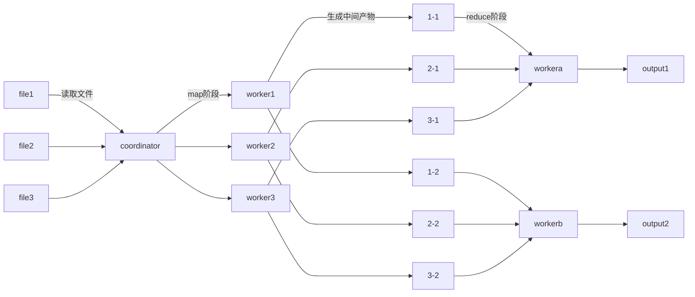

### 学习笔记

## lab1 MapReduce

coordinator:

预处理模块：处理文件信息，初始化任务队列

任务：第几个任务，哪一个文件，nReduce参数

任务队列：队列存任务，锁->发给worker没完成的还要重新加入队列

任务完成标记

worker:

处理map任务

处理reduce任务

处理完任务发送一个消息代表任务完成（不发送代表失败）

注：测试脚本wait -n运行不了，修改成wait

### 完成日志

完成rpc通信，传输基础数据

预处理分配map/reduce任务，初始化任务队列

提供get/post代表请求/完成任务接口

worker完成map/reduce处理

todo：直接加了一把大锁，在RPC层面就控制线程安全（实际上可以更细化）

### 可能的坑

待完善……