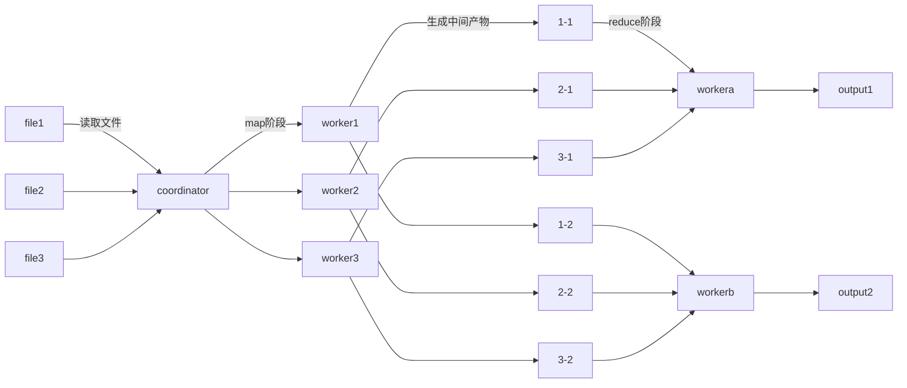
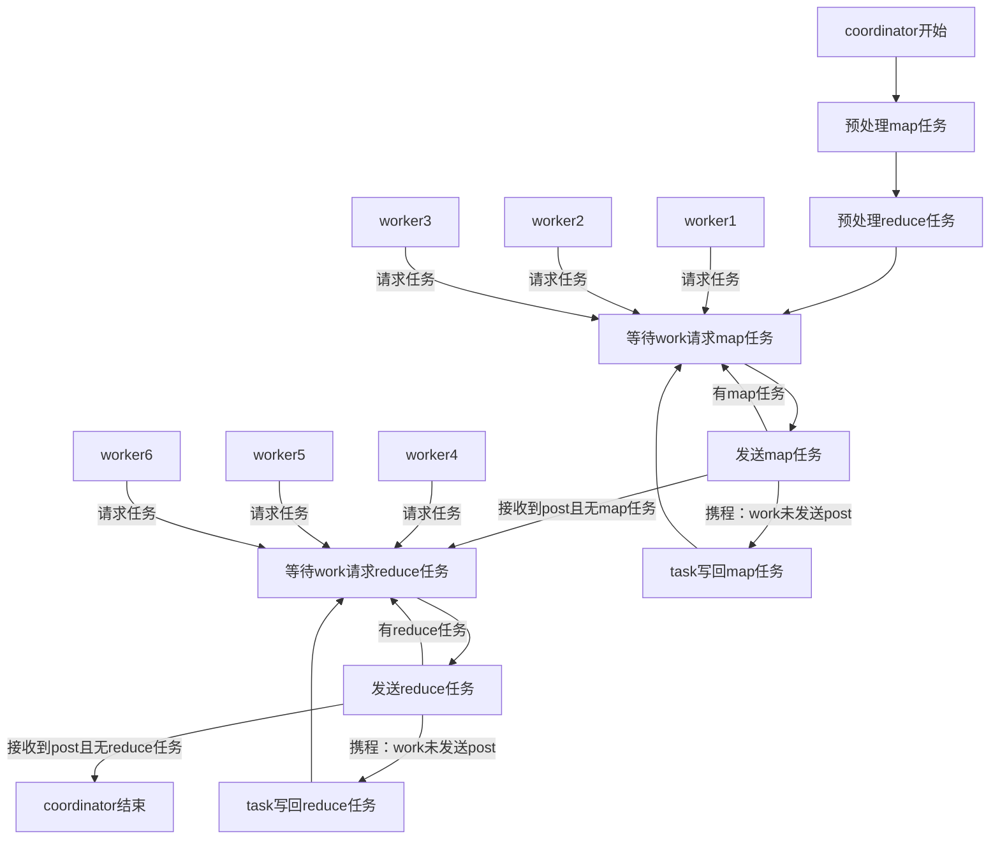

# lab1 MapReduce

## 前置知识

Golang语法及rpc相关

## 环境搭建

任务文件下载：详见任务书

```
git clone git://g.csail.mit.edu/6.5840-golabs-2023 6.5840
```

安装Golang环境（如果已有Golang环境，推荐卸载）：

```
wget -qO- https://dl.google.com/go/go1.13.6.linux-amd64.tar.gz | sudo tar xz -C /usr/local
```

如果还是失败，尝试更新路径：

```
vim ~/.bashrc
export PATH=$PATH:/usr/local/go/bin
source ~/.bashrc
```

## 任务说明

给定若干个文本文件，识别单词统计个数，并输出到文件 mr-out-0

形如:

```
A 1
B 23
...
Z 456
```

### 文件解释

下列给出本实验重要的相关文件：

```
src
├── go.mod
├── go.sum
├── kvraft
├── labgob
├── labrpc
├── main
│   ├── crash.so
│   ├── diskvd.go
│   ├── lockc.go
│   ├── lockd.go             
│   ├── mrcoordinator.go            入口函数：调用coordinator
│   ├── mrsequential.go             示例函数：用来测试、参考
│   ├── mrworker.go                 入口函数：调用worker
│   ├── pbc.go
│   ├── pbd.go
│   ├── pg-being_ernest.txt         文件输入
│   ├── pg-dorian_gray.txt          |
│   ├── pg-frankenstein.txt         |
│   ├── pg-grimm.txt                |
│   ├── pg-huckleberry_finn.txt     |
│   ├── pg-metamorphosis.txt        |
│   ├── pg-sherlock_holmes.txt      |
│   ├── pg-tom_sawyer.txt           文件输入
│   ├── test-mr-many.sh             测试脚本
│   ├── test-mr.sh                  测试脚本
│   ├── viewd.go
│   └── wc.so
├── models
├── mr                              lab1需要修改的文件
│   ├── coordinator.go              *修改文件1
│   ├── rpc.go                      *修改文件2
│   └── worker.go                   *修改文件3
├── mrapps                          测试脚本载入的不同插件
│   ├── crash.go                    work会随机退出（最困难） 
│   ├── early_exit.go
│   ├── indexer.go
│   ├── jobcount.go
│   ├── mtiming.go
│   ├── nocrash.go
│   ├── rtiming.go
│   ├── wc.go                       正常版本（最简单）   
├── porcupine
├── raft
├── shardctrler
└── shardkv
```

### 指令解释

下面解释本实验出现的部分指令：

把wc.go加载成插件的形式，后续会在work.go里用到mapf和reducef就是这个文件提供的函数（map和reduce）

```
go build -buildmode=plugin ../mrapps/wc.go
```
自测的时候在两个终端分别输入以下两个指令，分别启动一个coordinator和worker用来测试（视情况而定，自己也可以启动多个worker）

```
go run mrcoordinator.go pg-*.txt
go run mrworker.go wc.so
```

运行测试脚本，多组数据（通过不同的plugin来实现）

会启动1个coordinator和3个worker进行测试

测试脚本会在终端打印PASS/FAIL来提示是否通过

```
bash test-mr.sh
```

由于单组测试不稳定（crash会随机退出），推荐最终使用多组测试验证是否完成lab1任务

```
bash test-mr-many.sh 10
```

注：测试脚本wait -n运行不了，修改成wait

## 任务目标

补全coordinator.go/worker.go/rpc.go的代码

生成mr-out-0，mr-out-1，mr-out-2...mr-out-nReduce-1共nReduce个文件

下标通过哈希区分，对应的字符串写入对应的文件里。哈希函数在worker.go里

### coordinator.go：

1.预处理map任务：

假设文件数量为n，那就切分成n个任务，存入带锁任务队列

2.预处理reduce任务：

切分成nReduce个任务（这个参数由原代码提供），存入带锁任务队列

3.提供接口：给work提供任务

从任务队列里取任务，将相关参数下发给worker（如任务类型，任务下标等）

4.提供接口：接收work任务完成上报

打上任务完成的标记，如果map任务都完成，才开始发送reduce任务。如果在发送任务后没接收到work上报，将任务重新加入任务队列

### worker.go：

1.通过rpc向coordinator请求任务

2.处理map任务：

假设任务编号为x（x范围0到n-1），生成mr-x-y个中间文件(如mr-x-0,mr-x-1...)，y范围0到nReduce-1

其中y的生成法则是根据ihash(key)%nReduce而定的

3.处理reduce任务

假设任务编号是y，将所有的mr-x-y（x范围0到n-1）中间文件（如mr-0-y,mr-1-y...）整合成mr-out-y文件里

4.通过rpc通知coordinator任务完成

## 参考文献

lab1任务书：https://pdos.csail.mit.edu/6.824/labs/lab-mr.html

## 流程图



注：所有的map阶段完成后，才执行reduce阶段

注：worker1和worker2和workera可以是同一个work进程，但是请求到了不同的任务（不同时），也是允许的

注：生成中间文件mr-x-y（严格来说应该从0-0开始），x的范围是0到文件数-1，y的范围是0到nReduce-1

### coordinator流程图



## 可能的坑

极度推荐看任务书的Hints